<div align="center">

<a href="https://parakh-dashboard-five.vercel.app"><picture><source media="(prefers-reduced-motion: reduce)" srcset="docs/assets/readme/hero-poster.webp">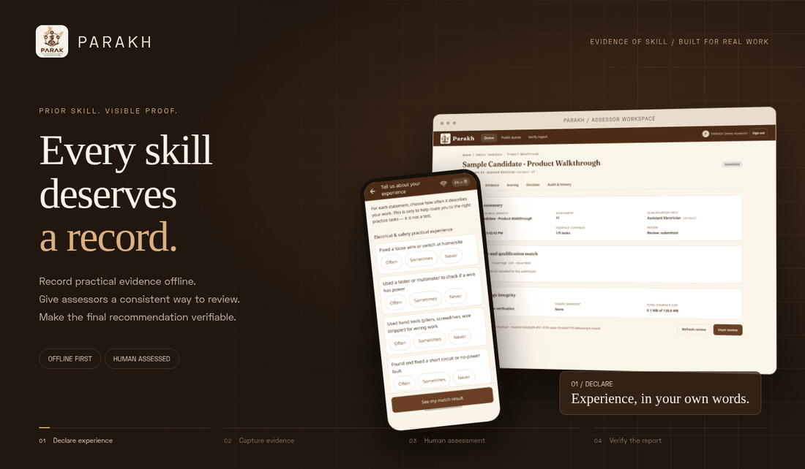</picture></a>

# PARAKH

### Every skill deserves a record.

**Prior-skill Assessment & Recognition through AI-driven Knowledge**

An offline-first platform for Recognition of Prior Learning. Workers record practical evidence on their phones; human assessors review it against shared skill criteria; the final recommendation becomes a signed, verifiable report.

[](https://github.com/Shreshtha280407/PARAKH/actions/workflows/ci.yml)


[](LICENSE)

**[Open the live dashboard ↗](https://parakh-dashboard-five.vercel.app)** · **[Verify a report ↗](https://parakh-dashboard-five.vercel.app/#/verify)**

[Watch the product](#see-it-in-action) · [Workflow](#from-experience-to-evidence) · [Architecture](#architecture) · [Run locally](#run-it-locally) · [Evidence](#verification-and-evidence) · [Roadmap](#where-parakh-goes-next)

</div>

---

## Skill should be easier to demonstrate

A worker can spend years learning a trade without a formal record of that experience. An assessment needs observable evidence, clear criteria, and a person accountable for the judgement.

PARAKH brings those pieces together. The worker prepares and records evidence without internet access. The assessor gets a structured workspace with recordings, scoring anchors, revision history, and an explicit final decision.

| For the worker | For the assessor | For someone checking a report |
|---|---|---|
| A guided Android journey in English or Hindi, with offline capture and later sync. | Task-linked evidence, criterion-by-criterion scoring, and targeted requests for better evidence. | A public Report ID or QR check, plus an independent offline verifier for downloaded PDFs. |

**The assessor makes the final recommendation.** PARAKH supports that decision with evidence and computation. Its reports are assessor recommendations, not official NCVET/MSDE qualification certificates.

## See it in action

### The worker's perspective

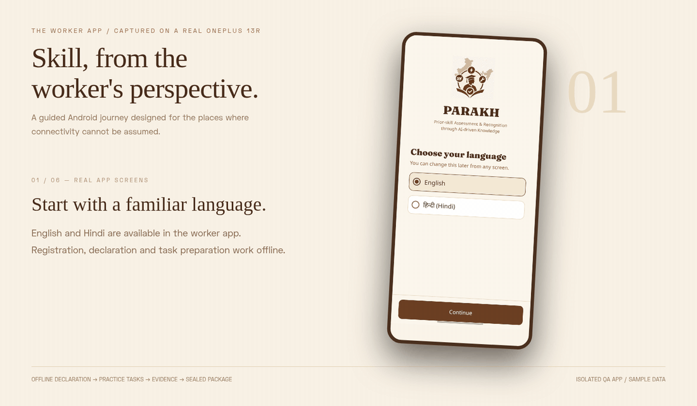

<p align="center"><sub>Real screens captured over USB on a OnePlus 13R, using the separate QA app and sample onboarding data. This animation sequences screen captures; it does not depict a completed practical assessment.</sub></p>

### The assessor's workspace

<a href="docs/assets/readme/assessor-review.mp4"></a>

<p align="center"><sub>Recorded with Playwright against the real local API and a disposable database. Candidate records, media fixtures and scores are demonstration data. <a href="docs/assets/readme/assessor-review.mp4">Watch the recording ↗</a></sub></p>

<details>
<summary><b>Tour the live website</b></summary>
<br>

<a href="https://parakh-dashboard-five.vercel.app">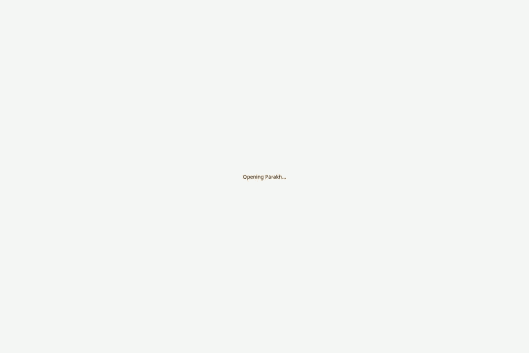</a>

Captured from **[parakh-dashboard-five.vercel.app](https://parakh-dashboard-five.vercel.app)**. [Watch the recording](docs/assets/readme/live-product-tour.mp4) · [Open the still image](docs/assets/readme/live-landing.webp).

</details>

## From experience to evidence

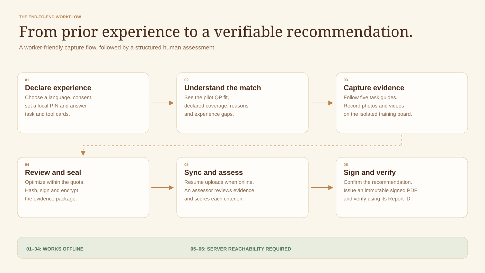

1. **Declare experience.** Choose a language, give consent, set a local security PIN, and answer task and tool cards.
2. **Understand the match.** See how the declaration fits the pilot qualification pack, with coverage, reasons, and gaps.
3. **Record the work.** Follow five task guides, capture photos or videos, and preview or retake evidence.
4. **Seal the package.** The app optimizes media, enforces the budget, hashes and signs the manifest, and encrypts local evidence.
5. **Sync and review.** Upload resumes when connectivity is available. An assessor reviews the evidence and records scores.
6. **Issue a recommendation.** The assessor confirms the decision. PARAKH stores the signed PDF and makes its authenticity verifiable.

### A guided Android experience

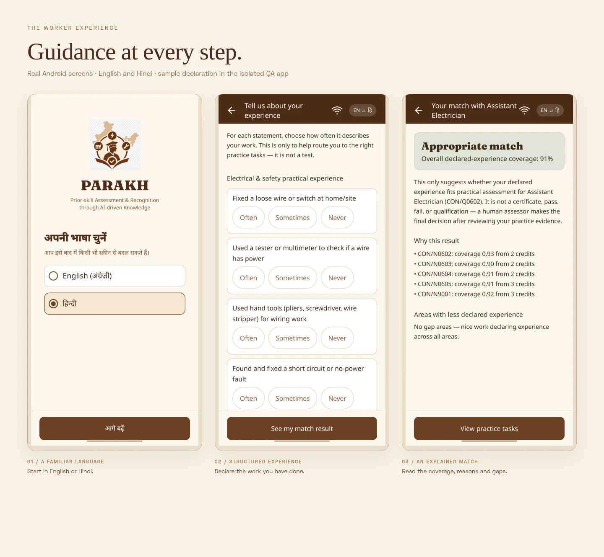

The declaration matcher uses **20 experience cards and six tool cards**. Its versioned rules run on the phone and explain the result. A declaration match indicates fit for the pilot assessment; it does not establish competence.

<details>
<summary><b>More app screens: tasks, instructions, and package review</b></summary>
<br>

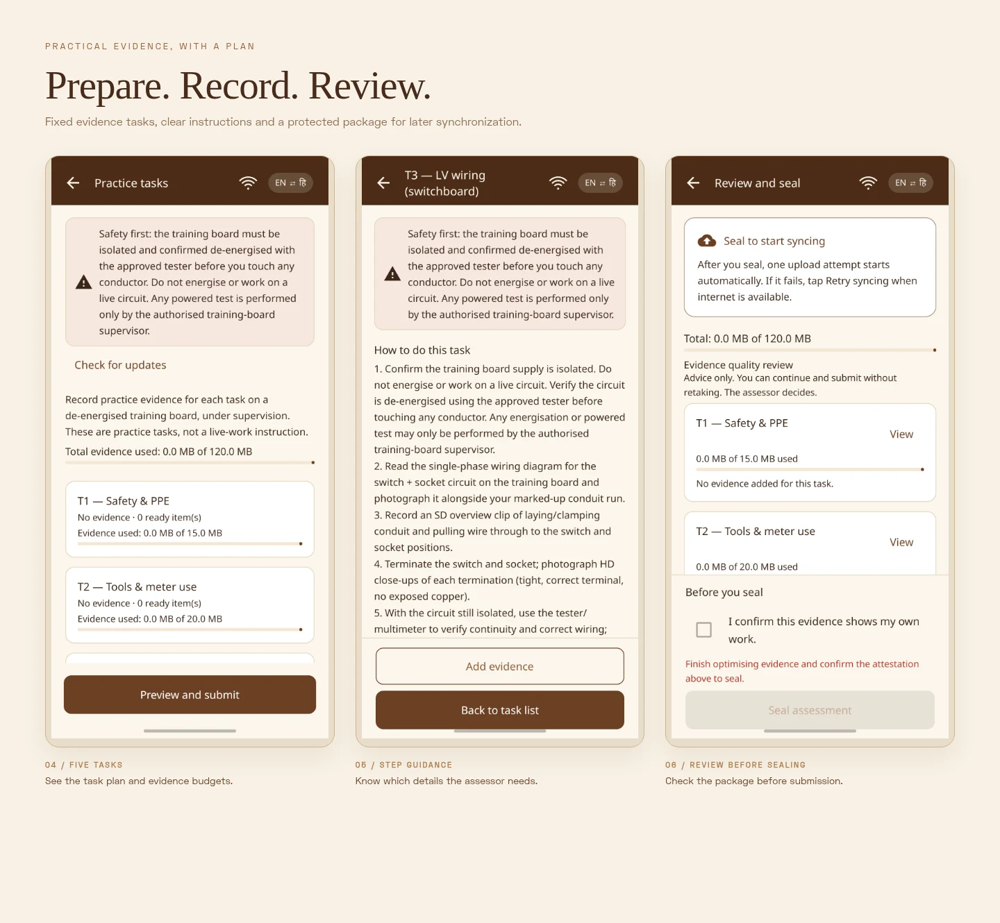

[Language](docs/assets/readme/app-language.webp) · [Hindi](docs/assets/readme/app-hindi.webp) · [Consent](docs/assets/readme/app-consent.webp) · [Registration](docs/assets/readme/app-registration.webp) · [Declaration](docs/assets/readme/app-declaration.webp) · [Match](docs/assets/readme/app-match.webp) · [Tasks](docs/assets/readme/app-tasks.webp) · [Task detail](docs/assets/readme/app-task-detail.webp) · [Review](docs/assets/readme/app-review.webp)

</details>

### Five tasks, with an explicit evidence budget

The pilot uses the bundled **Assistant Electrician pack, CON/Q0602 v4.0, NSQF level 3**. Each task has a fixed allowance; automatic optimization keeps final media within the combined ceiling.

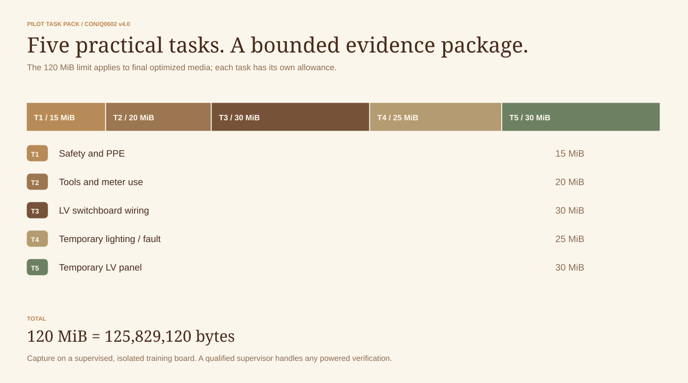

<details>
<summary><b>What the standards coverage means</b></summary>
<br>

A **Qualification Pack (QP)** groups occupational standards. A **National Occupational Standard (NOS)** describes an area of work. A **Performance Criterion (PC)** states what an assessor needs to judge.

The source-pinned pack contains **eight NOS and 119 PCs**: **71 have task-evidence pathways**, and **48 have declaration or assessor-note pathways**. One task-linked generator-maintenance criterion is outside the MVP setup, leaving **70 applicable task-linked criteria** in the pack's intended scope. The current scoring workspace still exposes 71 entries; consistent runtime exclusion of that N/A criterion remains a review item.

Task bundles, matching rules and 0–3 support rubrics are project assessment-support choices around the pinned source. Traceability of all 119 criteria does not mean all 119 have been demonstrated practically or independently validated.

[Inspect the pack](packs/ae-con-q0602/) · [Coverage matrix](packs/ae-con-q0602/coverage_matrix.csv) · [Technical acceptance](docs/gates/IC1A.md) · [Safety model](docs/safety.md)

</details>

## Built around the human assessor

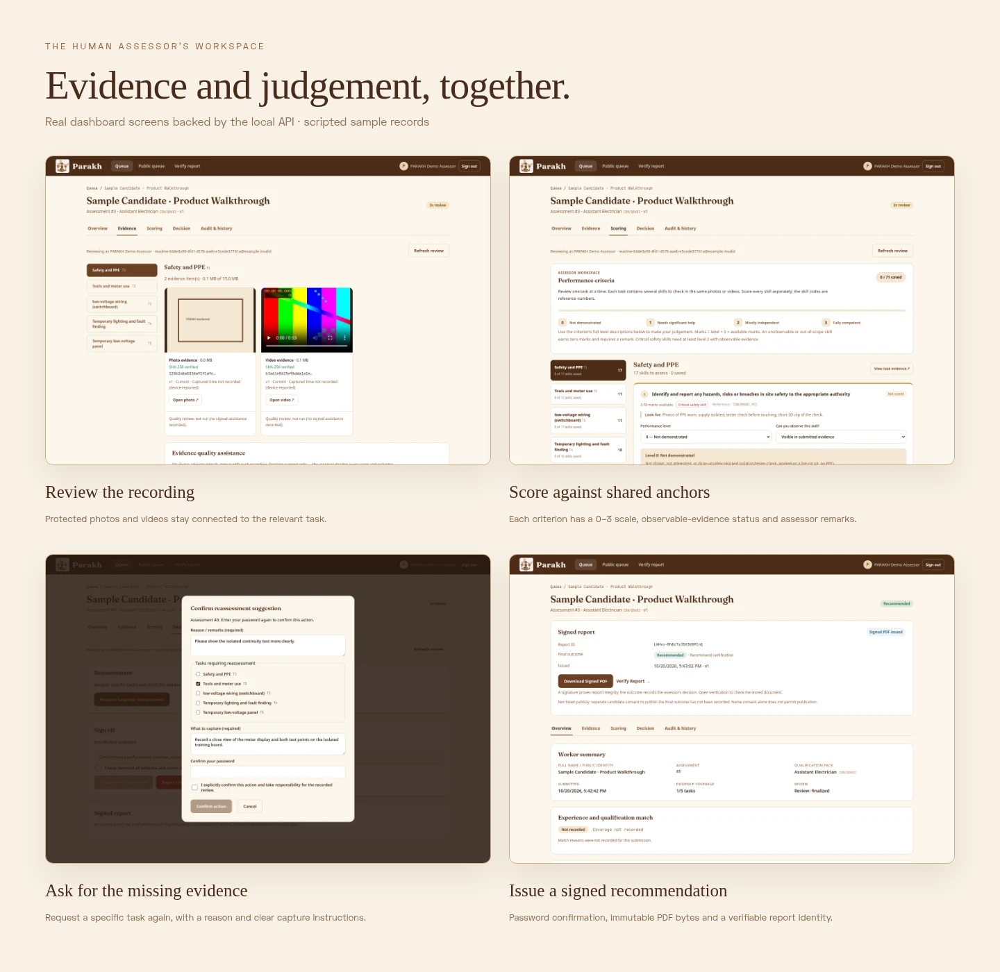

| The assessor needs to… | PARAKH provides |
|---|---|
| See what was submitted | Protected photos and videos, grouped by task, with available capture and integrity metadata. |
| Apply the same yardstick | Readable criteria, all four 0–3 anchors, evidence-observability status, and remarks. |
| Understand the recommendation | A computed competency profile with NOS summaries, thresholds, and critical-criterion checks. |
| Ask for better evidence | Task-specific reassessment with a required reason, instructions, and revision history. |
| Take responsibility for the outcome | Password-confirmed decisions, explicit confirmation, and a required reason for an override. |
| Revisit the decision | Saved scores, evidence revisions, and an append-only application audit trail. |

Full-size views: [Scoring](docs/assets/readme/dashboard-scoring.webp) · [Evidence](docs/assets/readme/dashboard-evidence.webp) · [Reassessment](docs/assets/readme/dashboard-reassessment.webp) · [Signed report](docs/assets/readme/dashboard-report.webp).

### Reassessment without repeating everything

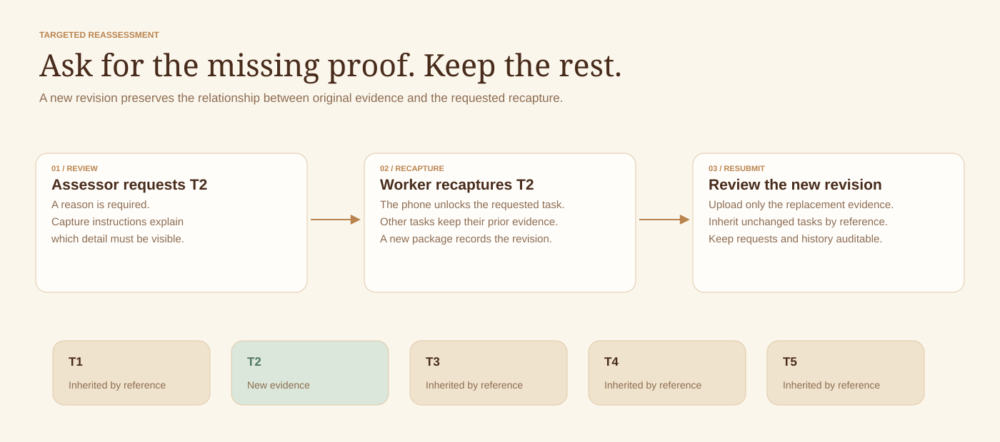

PARAKH reopens the requested tasks, retains the reason and instructions, and carries unchanged evidence forward by reference. The worker uploads replacement evidence instead of sending every task again.

### A report whose integrity can be checked

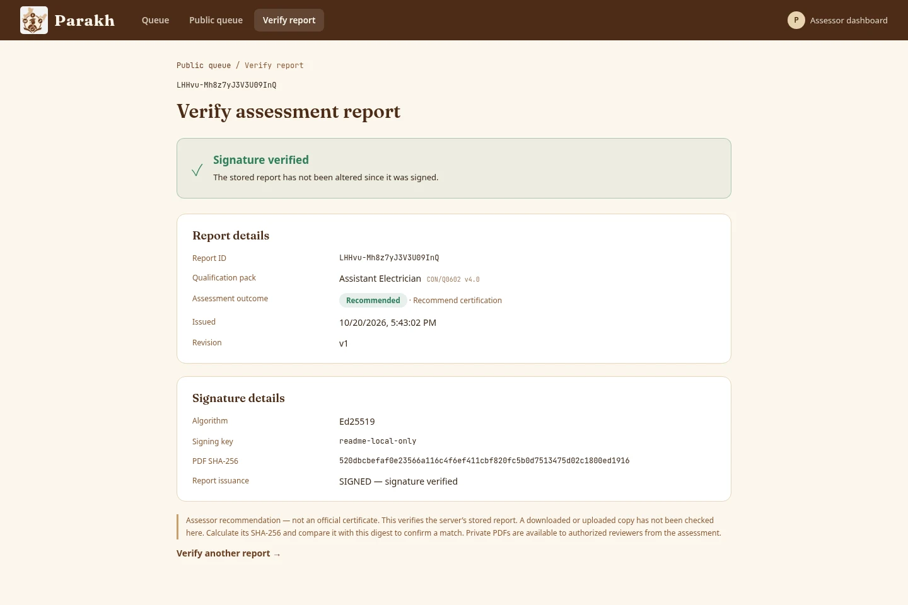

The PDF is stored once. A detached **Ed25519 receipt** signs its SHA-256 digest. Public verification checks the server's stored report and exposes minimal authenticity and outcome information. Positive and negative recommendations can both have valid signatures: authenticity describes the record, while the outcome records the assessor's decision.

To check a downloaded copy independently, obtain the PDF, its receipt, and a trusted public key:

```bash
python tools/verify_report.py assessment.pdf \
  --receipt assessment.pdf.receipt.json \
  --pubkey trusted-report-public-key.pem
```

The verifier recomputes the file digest and checks the signature locally. A changed PDF fails verification. [Verifier implementation](tools/verify_report.py) · [Signed-report regression evidence](docs/evidence/UNIVERSAL_SIGNED_REPORTS_20261019.md).

## Architecture

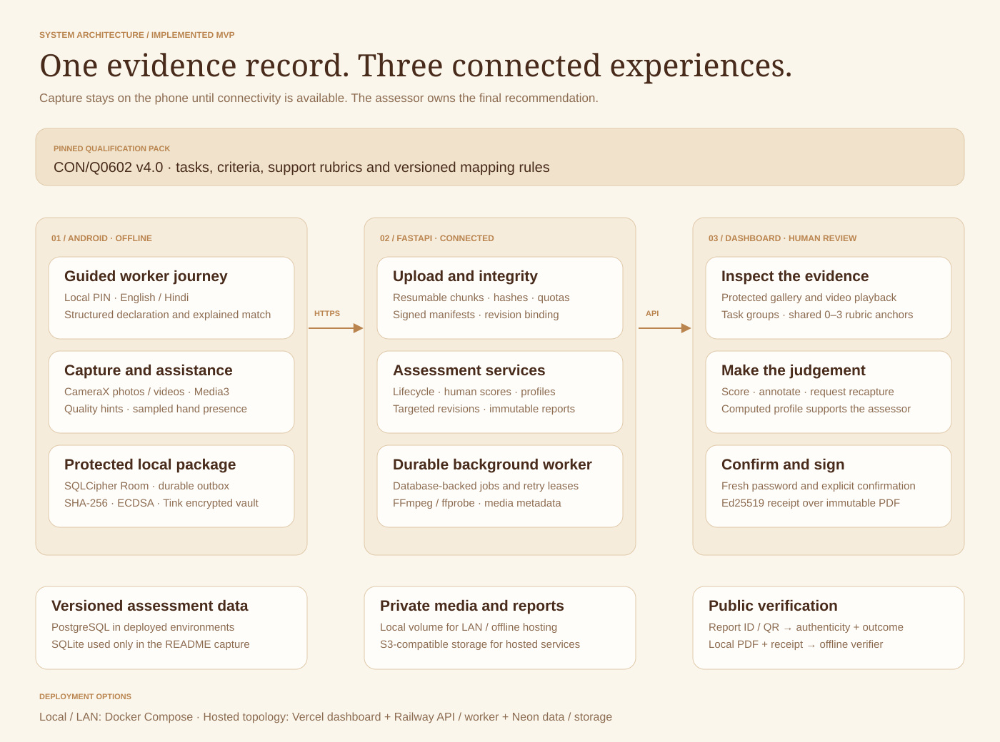

The application supports **local or LAN deployment** with Docker Compose and a **hosted topology** with a Vercel dashboard, Railway API and worker, and Neon PostgreSQL with private S3-compatible storage. Worker capture stays offline; synchronization and dashboard operations need a reachable server.

| Layer | Technology | Responsibility |
|---|---|---|
| Worker app | Kotlin, Jetpack Compose, CameraX | Intake, task guidance, photo/video capture and previews. |
| Media | Media3 Transformer | Automatic optimization within per-task and total byte budgets. |
| Local protection | Room, SQLCipher, Android Keystore, Tink | Durable drafts, protected identity, signatures and encrypted evidence. |
| Offline assistance | Quality metrics, MediaPipe Hand Landmarker | Recording-quality hints and sampled hand-presence observations. |
| Sync | WorkManager, resumable HTTP protocol | Background upload, retry, and revision-aware submission. |
| Backend | FastAPI, Pydantic, SQLAlchemy, Alembic | Authorization, integrity, lifecycle, scores, revisions and reports. |
| Processing | Database-backed jobs, FFmpeg / ffprobe | Retryable verification, thumbnails and metadata extraction. |
| Dashboard | React, TypeScript, Vite | Evidence review, scoring, decisions, history and verification. |
| Reports | SHA-256, Ed25519, PDF + detached receipt | Immutable artifacts and independent integrity verification. |

### How the evidence stays connected

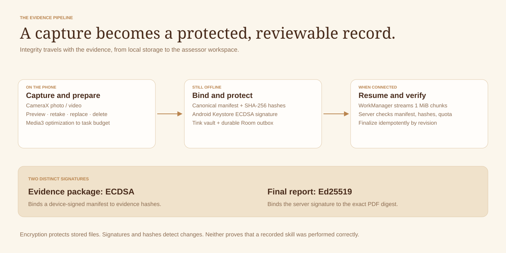

<details>
<summary><b>Technical sequence: sealed package → resumed upload → signed report</b></summary>
<br>

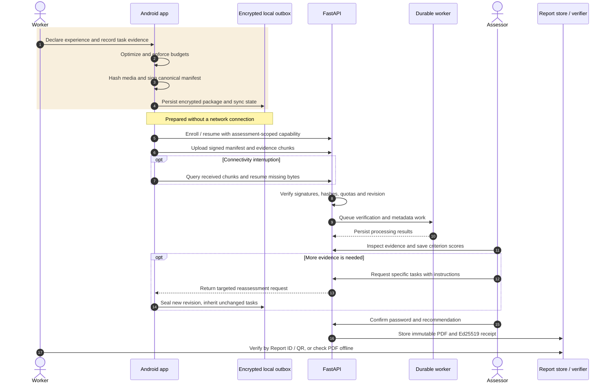

The phone streams **1 MiB chunks**; the configured server ceiling is **2 MiB per chunk**. Finalization binds the bytes to the claimed digest, quota, assessment and revision. [Manifest verification](server/app/manifest_verify.py) · [Sync implementation](apps/android/app/src/main/kotlin/in/kaushalpramaan/app/data/sync/) · [P6 protocol evidence](docs/gates/P6.md).

</details>

## What the AI assists with

On-device assistance makes recordings easier to review. The current qualification matcher is deterministic: it uses versioned card, tool and keyword rules rather than a language model.

| Implemented assistance | Contribution | Human judgement |
|---|---|---|
| Technical-quality checks | Flags lighting, blur and camera-motion issues. | The worker can recapture; the assessor judges usability. |
| Sampled hand presence | Reports detected hands and gaps at sampled timestamps. | The assessor interprets the demonstrated work. |
| Declaration matching | Explains fit and gaps within the pilot QP. | The result guides preparation for assessment. |
| Computed competency profile | Summarizes human scores against configured rules. | The assessor owns the final recommendation. |

<details>
<summary><b>Measured results and their limits</b></summary>
<br>

| Check | Recorded result | Scope |
|---|---|---|
| Matcher reproducibility | 100 deterministic golden vectors | Rule consistency; no independent worker-accuracy claim. |
| Technical-quality proxy v3 | 92.52% precision, 92.52% recall | 187 judgeable captures from the calibration collection. |
| Hand-presence proxy | 75.79% sample agreement | 475 judgeable timestamp labels from 40 clips, after gap filling. |
| Device integration | Dated functional runs on OnePlus 13R | Capture, recovery, seal, upload, revisions and assistance. |

Proxy results use calibration data without an independent holdout. They do not establish field accuracy, other-device performance, or assessor agreement. Hand presence does not meet the original ≥90% agreement target. The synthetic assessor study validates a statistics harness; it is not a study of real assessors.

[Quality report](ml/quality/reports/quality-proxy-v3-android-parity.json) · [Hand report](ml/hands/reports/hands-proxy-v3-final-gapfilled.json) · [Acceptance matrix](docs/gates/Q2_Q3_acceptance.md) · [Synthetic-study scope](ml/study/reports/synthetic_validation.md).

</details>

## Run it locally

The full stack needs **Docker Engine and Docker Compose v2**. Initial builds download dependencies; an exported image bundle supports later startup without internet access.

```bash
git clone https://github.com/Shreshtha280407/PARAKH.git
cd PARAKH
cp .env.example .env
```

Set `REPORT_SIGNING_PRIVATE_KEY` in `.env` to a persistent 32-byte hex seed, and replace the JWT and local assessor password placeholders. Generate the report key once:

```bash
python3 -c "import secrets; print(secrets.token_hex(32))"
```

Start the stack and load the local demonstration data:

```bash
docker compose -f infra/docker-compose.yml up -d --build
docker compose -f infra/docker-compose.yml exec api python -m app.seed
```

| Service | Local address |
|---|---|
| Assessor dashboard | [localhost:5173](http://localhost:5173) |
| API documentation | [localhost:8000/docs](http://localhost:8000/docs) |
| Health check | [localhost:8000/health](http://localhost:8000/health) |

Docker defaults to organizational/private access. Sign in with the local assessor email and password in `.env`. Seeding creates sample workers and assessments; for a clean deployment, import the pack and provision an assessor using the [deployment guide](docs/deployment/README.md).

<details>
<summary><b>Android, frontend development, and offline hosting</b></summary>
<br>

With a JDK and the Android SDK configured:

```bash
cd apps/android
./gradlew :app:assembleDebug
./gradlew :app:installDebug
```

Release builds need an HTTPS API endpoint and approved release-signing configuration. Debug builds can use a configured LAN endpoint. [Android guide](apps/android/README.md).

For dashboard development with a reachable local API:

```bash
cd apps/dashboard
npm ci
npm run dev
```

Prepare an offline server deployment by exporting images while connected, transferring the checkout and archive, and starting from imported images:

```bash
python3 tools/offline_bundle.py export --out parakh-offline-images.tar
docker load -i parakh-offline-images.tar
docker compose -f infra/docker-compose.yml up -d --no-build --pull never
```

The target machine also needs its deployment configuration. [Offline/LAN instructions](docs/deployment/README.md#3-offline--lan-deployment) · [Infrastructure guide](infra/README.md).

</details>

## Verification and evidence

The [CI workflow](.github/workflows/ci.yml) checks the pinned pack, backend and contracts, Kotlin parity, Android builds, dashboard, browser workflows, tooling, Docker smoke tests and offline startup. The badge links to its current result; historical gate counts remain dated evidence.

**Fresh checks for this README:** pack validation and source traceability passed; all **17 matcher structural checks** and **100 golden vectors** passed; English/Hindi resource parity passed. The Android capture driver completed on the connected phone. Browser capture verified a saved score, report issuance, matching PDF digest and anonymous verification, with **zero JavaScript page errors** in the recorded local flow. [Capture record](docs/assets/readme/capture-manifest.json).

```bash
python3 tools/pack_validate.py packs/ae-con-q0602
python3 tools/audit_qp_traceability.py packs/ae-con-q0602
python3 ml/mapping/test_matcher.py
python3 ml/mapping/test_golden_vectors.py
python3 tools/check_android_string_parity.py
```

The full backend suite needs a [dedicated test database](server/README.md#tests); its concurrency check requires real PostgreSQL. The README's disposable SQLite capture validates the demonstrated UI flow, without establishing production concurrency or cloud performance.

[Phase and evidence index](docs/readme/IMPLEMENTATION_STATUS.md) · [Performance measurements](docs/perf.md) · [How the media was captured](docs/readme/MEDIA.md).

## Security and scope

- **Protected local evidence:** SQLCipher drafts, Keystore-backed secrets, an encrypted vault, and a local PIN with retry controls. Production screens block screenshots and app-switcher previews.
- **Bound submissions:** assessment-scoped capabilities, signed manifests, digest checks, quotas, and revision-aware resumable uploads.
- **Private review:** recordings and complete reports require authorization. Public summaries respect name consent; outcome listing requires separate publication consent.
- **Accountable decisions:** password-confirmed actions, override reasons, optimistic score versions, and application audit entries.

Current public-dashboard assessor accounts are self-registered. Contact details and assessor credentials are not independently verified; approved-roster access and scoped assignments remain pilot-hardening work. A local PIN is not proof of identity, and a signature does not establish the correctness of a skill judgement.

The MVP covers one occupation. Face liveness, identity bookends, automated PPE/tool assessment, VLM criterion suggestions, independent assessor-agreement validation, and entry/mid-tier phone guarantees remain future work or unproven targets.

## Where PARAKH goes next

| Horizon | Work |
|---|---|
| **Implemented foundation** | Offline intake, one pinned QP, real capture, advisory quality/hand analysis, protected sealing, resumed sync, human scoring, targeted revisions and verifiable reports. |
| **Next: strengthen the pilot** | Verify assessor authority; reconcile N/A criterion handling and mapping-weight documentation; validate release delivery; run expert review and independent worker studies. |
| **Then: richer assessment support** | Evaluate face liveness and identity bookends, PPE/tool detection, timestamped criterion evidence and schema-constrained vision-language suggestions. |
| **Later: broader access** | Additional source-pinned trades, languages, knowledge/viva workflows, lower-cost devices, and authorized certification-system integrations. |

The KaushalPramaan master design informs this direction. Its proposed YOLO and Qwen pipeline, compression targets and processing-time targets describe planned work. [Roadmap and design boundaries](docs/readme/ROADMAP.md).

## Find your way around

```text
apps/android/          Offline worker app, capture, assistance, seal and sync
apps/dashboard/        Assessor workspace and public report verification
server/                FastAPI services, worker, migrations and tests
packs/ae-con-q0602/     Pinned QP, tasks, rubric, coverage and matching rules
contracts/             API and signed-assistance schemas and fixtures
ml/                    Matching, quality/hands evaluation and study harnesses
infra/                 Local Compose stack and hosted configuration
tools/                 Audits, verification, deployment and capture tooling
docs/                  Contracts, gates, measurements and evidence
```

| Start here | Read |
|---|---|
| Build a component | [Android](apps/android/README.md) · [Dashboard](apps/dashboard/README.md) · [Backend](server/README.md) |
| Understand assessment | [Pack](packs/ae-con-q0602/) · [Matcher](ml/mapping/README.md) · [Evidence semantics](docs/evidence_status_model.md) |
| Inspect trust boundaries | [Worker capabilities](docs/worker_capability_tokens.md) · [Assistance contracts](docs/assistance_modules.md) · [Report verifier](tools/verify_report.py) |
| Deploy and operate | [Infrastructure](infra/README.md) · [Deployment guide](docs/deployment/README.md) · [Hosted release notes](docs/deployment/OPEN_ACCESS_RELEASE.md) |
| Review evidence | [Implementation index](docs/readme/IMPLEMENTATION_STATUS.md) · [Measurements](docs/perf.md) · [Capture notes](docs/readme/MEDIA.md) |

<div align="center">

<br>

**PARAKH · Prior skill. Visible evidence. Human judgement.**

[Explore the live dashboard ↗](https://parakh-dashboard-five.vercel.app)

</div>
