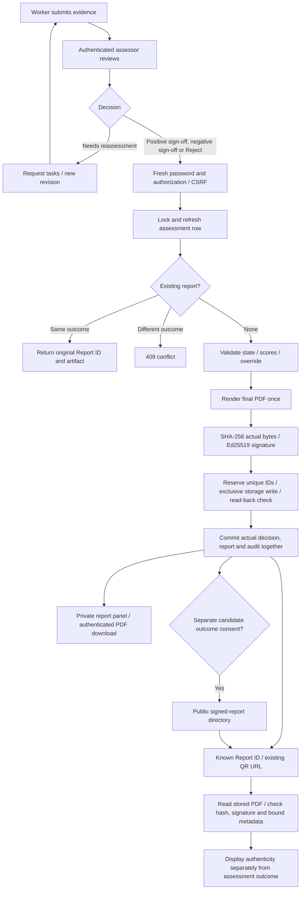

# Universal signed assessment reports — local review

Date: 19 October 2026. Baseline: `faa78d3`.

All implementation changes are in the local working tree for manual review. No commit, push, deployment, release, hosted migration, live credential change or production-data modification was performed. Android code and the worker submission payload were not changed.

## 1. Summary and audit findings

The audit followed enrollment/submission, reviewer authorization, human scoring, decision, reassessment, PDF signing/storage, public projection and verification in the actual routers and dashboard. The original Reject route finalized `not_recommended` without a report, while Sign Off always persisted `recommended` even when the PDF recorded a negative final recommendation. The legacy decision endpoint could also finalize without creating a signed report. Public name consent did not explicitly authorize publication of an adverse outcome.

Positive sign-off, negative sign-off and explicit rejection now share one finalization operation. It issues an immutable PDF and Report ID, preserves computed versus final recommendations, and persists the actual final decision. A signature proves document authenticity; it never implies that a candidate qualified.

| Action/outcome | Persisted status and decision | Report behavior |
| --- | --- | --- |
| Sign Off: `RECOMMEND_CERTIFICATION` | `recommended` | Signed final report; Recommended |
| Sign Off: `NOT_YET_COMPETENT` | `not_recommended` | Signed final report; Not Recommended |
| Sign Off: `PARTIALLY_COMPETENT` | `not_recommended` | Signed final report; Not Recommended; detailed recommendation retained |
| Reject, with an explicit reason | `not_recommended` | Same signing operation; final `NOT_YET_COMPETENT`; rejection reason/action preserved in snapshot and audit |
| Needs Reassessment / insufficient evidence | Existing reassessment state machine | No new final report; revision/reopened criteria must be reviewed |
| Submitted / In Review | Existing non-final state | No final report |

Reject can record a reasoned unsuccessful assessment without inventing scores for unreviewed criteria. Ordinary Sign Off requires every rubric criterion to be human-confirmed. An override of the computed recommendation requires a reason. `INSUFFICIENT_EVIDENCE` is rejected as a new final sign-off and remains in the reassessment workflow.

## 2. Architecture and consistency



`reports._finalize_authorized()` is the common transaction boundary. Its callers prove authorization and the assessor's password on every attempt, including retries. Password-account reviewer mutations retain CSRF checks. Legacy email-code capabilities alone can no longer finalize a signed report; a password-based assessor account is required. Organizational assessor sign-off continues to check the authenticated user's own password.

The finalizer takes a fresh PostgreSQL row lock with `populate_existing=True`, checks pending reassessment/stale scores and serializes against scoring and reassessment. Existing unique report constraints remain in use. Concurrent identical requests return the same report; concurrent conflicting requests yield one winner and a 409. Reasons, identity, timestamps and artifacts are never replaced on a retry.

The PDF contains the real outcome, qualification, revision, human scoring evidence, reviewer identity and signing time. New PDFs also contain a small encoded public-metadata record in their signed PDF Subject. Verification compares that signed metadata with the database fields. Ed25519 still signs the SHA-256 digest of the actual final PDF bytes, as in the existing architecture. The informational JSON snapshot remains an unsigned export, not an independent signed credential.

The finalizer renders once, hashes/signs, flushes the unique report row, writes through `Storage.write_once`, verifies a read-back and commits the decision/report/audit together. Rendering, signing, storage or confirmation failures return a generic 503 and roll back the uncommitted decision. A potentially written, unreferenced private PDF is retained on failure: deleting after an ambiguous commit acknowledgement could destroy a genuinely committed artifact. A password-confirmed retry resolves the committed report or creates a fresh unique artifact. No automatic orphan deletion was added.

Local storage uses an exclusive atomic link from a flushed temporary file. S3 storage uses a conditional create with `IfNoneMatch="*"`, failing closed if the provider cannot honor it. This follows [Amazon S3 conditional-write semantics](https://docs.aws.amazon.com/AmazonS3/latest/userguide/conditional-writes.html). Existing generic evidence writes are unchanged. This is application-level immutability, not bucket retention/WORM protection against a storage administrator.

## 3. Public directory, verification and privacy

`GET /public/reports` includes only candidate-enrolled, finalized assessments with a signed report for the current revision and explicit outcome-publication consent. Both Recommended and Not Recommended appear with candidate display identity, qualification, final outcome, Report ID, issuance date and Verify Report link. Directory inclusion means a signed artifact was issued; the Verify action performs cryptographic validation. The directory does not label unexamined artifacts as cryptographically verified.

The existing `/public/assessments` endpoint remains available. Without outcome consent it masks a finalized outcome as `finalized`, omits Report ID/outcome/issuance date and does not expose report availability. Private reviewer queue data now comes from authenticated `/reviewer/queue`, with separate client state/cache scope. Private decisions are never written into the public queue cache.

Name consent and outcome-publication consent are independent. Without name consent, the safe display identity remains `Candidate #<id>`. Names are never added to public verification responses. Public directory/verification responses do not contain phone numbers, email addresses, raw evidence, evidence URLs or detailed scoring. Existing submitted-assessment summary visibility and name-consent behavior are otherwise preserved; this work is not a redesign of all public enrollment visibility.

New candidate-only consent endpoint:

```http
PUT /assessments/{assessment_id}/public-outcome-consent
X-Worker-Token: <that assessment's active capability>
Content-Type: application/json

{"consent":true,"consent_version":"public-outcome-v1"}
```

Use `false` with the same version to revoke. Assessor/reviewer authorization alone cannot grant this consent. The server records disclosure version, time and an audit event. Candidate consent is a default-off capability, not an assessor toggle.

Suggested candidate-facing disclosure for a future consent UI: “I agree that my final assessment outcome, including Not Recommended, qualification, Report ID and issuance date may appear in PARAKH's publicly searchable report directory. My name appears only if I separately consented to name publication. I can withdraw directory consent. Anyone who already has a Report ID can still verify its authenticity.”

**Current integration limitation:** Android has no new consent screen in this change. Existing submissions therefore remain unpublished in the final-outcome directory until a candidate-controlled client collects the explicit disclosure and invokes the endpoint. Do not infer consent from enrollment, name consent, sign-off or an assessor action. A future candidate consent UI needs a separate reviewed change; no worker submission-contract change is required.

`GET /verify/{report_id}` and the legacy `/reports/{assessment_id}/verify` continue to check the stored PDF's actual SHA-256 and Ed25519 signature. New reports also check signed display metadata. Missing IDs return 404; tampering, missing artifacts or unknown signing keys cannot verify successfully. Public verification is anonymous and uses no-store responses/requests. An authentic unsuccessful report shows **Signature verified** and **Not Recommended** independently. Failed verification shows an error banner and an **Unverified recorded outcome**, with failure colours rather than a success badge.

The page explicitly checks the server's stored artifact. It does not claim that a user's local/uploaded copy was checked. Authenticated PDF download checks the exact served bytes, uses `private, no-store` and `nosniff`, and blocks invalid artifacts with 409. Existing protected receipt/JSON endpoints remain protected and use private/no-store responses. Independent offline verification still works with the existing `tools/verify_report.py`, the detached receipt and a separately trusted public key.

## 4. Database impact and compatibility

Additive migration `f71a920ce134` follows `e53a28c09b12` and adds only:

- `assessments.public_outcome_consent`: non-null boolean, false by default.
- `assessments.public_outcome_consent_version`: nullable string.
- `assessments.public_outcome_consent_recorded_at`: nullable timestamp.

No report, assessment outcome or historical signature is deleted, rewritten or backfilled. The migration was exercised only on disposable local database fixtures, including preservation of a historical report. It was **not applied to staging or any hosted database**. It must be reviewed and applied through your approved migration process before deploying code that reads the new columns. The downgrade deliberately refuses to discard recorded consent; roll back application code without deleting consent history.

Existing report IDs, QR URLs, verification endpoints, Ed25519 keys/key-history resolution, detached receipts and private download URLs remain valid. Historical PDFs without the new signed-metadata marker still verify against their original bytes/signatures; the page explains that their display metadata predates cryptographic binding and the signed PDF is authoritative. Already-signed historical `INSUFFICIENT_EVIDENCE` records remain verifiable; no new such finalization is allowed.

Historical signed reports whose assessment status disagrees with the report are projected using the report's actual recommendation in protected detail, queues and worker updates. Stored historical rows/PDFs remain unchanged; this change does not silently repair historical database values. Legacy unsigned rejected records remain unsigned, have no fabricated Report ID and never enter the signed-report directory. Keep them as legacy decisions; if a signed reassessment is required, arrange a legitimate new assessment/review under the existing workflow rather than manufacturing a historical signature.

Intentional API hardening: the legacy `/assessments/{id}/decision` URL and response shape are preserved, but final positive/negative decisions now require fresh password proof and shared finalization. Positive sign-off requires human-confirmed rubric scores. Clients that previously created unsigned final decisions or used an email-code capability alone to finalize must update. Existing reassessment behavior is retained.

The Android submission routes and payloads are unchanged. Additive response fields are compatible with the existing client's unknown-field handling. This task did not build, reinstall or instrument the phone app.

## 5. Changed files

All paths below are relative to the repository. Several implementation/test files are new and untracked; plain `git diff` does not display their contents until you explicitly include/review them.

| File | Purpose |
| --- | --- |
| `server/app/report_outcomes.py` (new) | One explicit fine-recommendation to final-decision/label mapping. |
| `server/app/routers/reports.py` | Common locked finalizer; correct PDF outcome and unscored evidence; read-back integrity; metadata-aware verification; protected exact-byte downloads. |
| `server/app/report_signing.py` | Encode/read the public fields bound into newly signed PDFs; preserve existing Ed25519 mechanism and key history. |
| `server/app/routers/reviewer.py` | Reject and Sign Off reuse finalization; require password accounts for signing; add private reviewer queue. |
| `server/app/routers/decisions.py` | Close unsigned legacy-final-decision bypass; require password and shared finalizer; refresh locked state. |
| `server/app/routers/reassessment.py` | Refresh locked state to prevent stale-session reopen after concurrent finalization; project report outcome in worker updates. |
| `server/app/routers/assessments.py` | Candidate-only audited outcome consent; additive protected report metadata; correct historical signed-outcome projection. |
| `server/app/routers/public.py` | Consent-aware safe projections and signed-report directory; preserve name privacy; no-store responses. |
| `server/app/routers/verify.py` | Shared actual-artifact cryptographic verification; bound metadata indicator; no-store response. |
| `server/app/storage.py` | Exclusive local/S3 write-once report creation; retain existing evidence storage operations. |
| `server/app/models.py` | Negative assessment status typing and outcome-consent fields. |
| `server/app/schemas.py` | Additive consent/report/issuance/metadata-binding DTO fields. |
| `server/alembic/versions/f71a920ce134_public_outcome_consent.py` (new) | Additive, default-off consent migration with no historical report rewrite. |
| `contracts/openapi.json` | Regenerated API contract for the new routes/fields and password-confirmed legacy decision. |
| `apps/dashboard/src/components/SignedReportPanel.tsx` (new) | Shared issued-report indicator, outcome, Report ID/date/revision, Verify/Download actions and publication explanation. |
| `apps/dashboard/src/pages/OpenAssessmentPage.tsx` | Report panel for either final outcome; accurate rejection/sign-off and cache invalidation; reassessment/unsigned legacy states. |
| `apps/dashboard/src/pages/AssessmentDetailPage.tsx` | Both outcomes supported in private legacy mode; readable final choices; insufficient evidence cannot finalize; common report panel. |
| `apps/dashboard/src/pages/PublicQueuePage.tsx` | Separate private/public/report queue sources; consented positive/negative report rows; accurate badges and empty/loading states. |
| `apps/dashboard/src/pages/VerifyReportPage.tsx` | Separate authenticity/outcome; search/not-found/error states; historical metadata caveat; actual-copy digest explanation. |
| `apps/dashboard/src/PrivateApp.tsx` | Anonymous blank-ID report search remains available in private dashboard mode. |
| `apps/dashboard/src/api.ts` | Separate public/private queue endpoints and invalidation; remove private-to-public row cache updates; anonymous/no-store verification request. |
| `apps/dashboard/src/types.ts` | Additive protected signed-report, consent and public issuance-time types. |
| `apps/dashboard/src/presentation.ts` | Readable coarse final-outcome labels without losing fine recommendation text. |
| `apps/dashboard/src/components/DashboardShell.tsx` | Normalize multiword status classes so outcome badges retain theme colours. |
| `apps/dashboard/src/components/ReviewerConfirmation.tsx` | Explain that Reject issues a signed negative report. |
| `apps/dashboard/src/assessment.css` | Scoped report panel, issuance indicator and unverified/failure styles; responsive theme preserved. |
| `apps/dashboard/package.json` | Add `test:reports` command; no dependency changes. |
| `server/tests/test_universal_reports.py` (new) | Real API/PDF/signature regressions, privacy, password/CSRF, idempotency, PostgreSQL concurrency, failure rollback, legacy and reassessment race coverage. |
| `server/tests/test_decisions.py` | Password-confirmed final-decision and unsigned-bypass regressions. |
| `server/tests/test_open_access.py` | Explicit publication consent; password-only finalization; legacy OTP signing rejection; complete human-score requirements. |
| `server/tests/test_open_access_migration.py` | Default-off consent and historical report preservation through migration. |
| `server/tests/test_storage.py` | Local write-once collision preserves original bytes. |
| `server/tests/test_storage_s3.py` | S3 conditional-write collision preserves original bytes, using moto fixtures. |
| `apps/dashboard/e2e/universal-reports.mjs` (new) | Real local browser/API/PDF workflow, tamper/download failure, consent/revocation, missing ID, negative/positive metadata and mobile assertions. |
| `apps/dashboard/e2e/open-access.mjs` | Align existing full review/media regression with report controls and completion popup. |
| `apps/dashboard/e2e/review-responsive.mjs` | Exercise local isolated API, private queue separation and correct signed-negative completion/queue behavior. |
| This review document and `UNIVERSAL_SIGNED_REPORTS_20261019/` | Synthetic browser screenshots, check receipt and review/validation notes; no live candidate data or credentials. |

## 6. Validation actually run

Backend tests ran on real disposable local PostgreSQL databases, not hosted Neon and not an existing application database. A guarded temporary runner checked the loopback source, selected fresh `parakh_reports_unit_20261019` / `parakh_reports_browser_20261019` fixture databases, supplied temporary local storage and ephemeral signing secrets in memory and avoided printing credentials. The existing suite's fixtures reset/drop their test tables, so **never point `TEST_DATABASE_URL` at a database containing data you want to retain**.

| Command executed | Actual result |
| --- | --- |
| `server/.venv/bin/python /tmp/parakh-universal-reports-local.py tests` (runs `python -m pytest server/tests -q --tb=short` in the isolated environment) | **354 passed**, 1 pre-existing Starlette/httpx deprecation warning; 213.35 seconds. |
| `P8_CHROME=/opt/google/chrome/chrome node apps/dashboard/e2e/universal-reports.mjs` | **12 checks passed**, no JavaScript errors; rerun successfully after the final failure-colour correction. |
| `OPEN_API_URL=http://127.0.0.1:18188 OPEN_DASHBOARD_URL=http://127.0.0.1:18187 P8_CHROME=/opt/google/chrome/chrome node apps/dashboard/e2e/open-access.mjs` | **12 checks passed**; includes real JPEG/H264 playback, ranges, expiry/retry, scoring, signing, reassessment, rejection and assessor sessions. |
| Same loopback environment with `node apps/dashboard/e2e/review-responsive.mjs` | **3 checks passed**, no JavaScript errors; measured local history-tab 66 ms, scoring-tab 150 ms, private-queue 123 ms in that run. These are local observations, not production latency claims. |
| `npm run build` in `apps/dashboard` | **Passed**, including TypeScript `tsc -b` and Vite production build; rerun after the final UI change. |
| `npm run lint` in `apps/dashboard` | **Passed with 0 errors and 9 warnings** (existing unused import, component-export and effect/ref warnings in dashboard files). |
| `server/.venv/bin/python /tmp/parakh-universal-reports-local.py command tools/export_openapi.py --check` | **Passed**; generated contract matches routes/schemas. |
| `git diff --check` | **Passed**. |

The full backend run covers actual PDF content/digest/signature validation, both negative fine recommendations, stored negative decisions, wrong/missing password and CSRF, missing ID, tampered PDF/signature/metadata, missing storage, both same/conflicting concurrent HTTP finalizations, authenticated retry idempotency, public data/identity boundaries, consent/revocation, legacy signed/unsigned records, migration preservation, reassessment and stale ORM identity-map races. Failure injection covers PDF rendering, signing, storage write/read-back and final database commit; successful retry is checked.

The browser suite changes only fixture files beneath `/tmp/parakh-universal-reports-storage` for its tamper test and restores them in `finally`. There is no product tampering endpoint. Screenshots use synthetic candidates/accounts only. See [browser check receipt](UNIVERSAL_SIGNED_REPORTS_20261019/verification.json), [negative phone report](UNIVERSAL_SIGNED_REPORTS_20261019/negative-detail-phone.png), [valid negative verification](UNIVERSAL_SIGNED_REPORTS_20261019/negative-verification-phone.png), [tamper failure](UNIVERSAL_SIGNED_REPORTS_20261019/tamper-failure-phone.png) and [public signed outcomes](UNIVERSAL_SIGNED_REPORTS_20261019/public-signed-outcomes.png).

Not run: hosted/staging integration, live S3-compatible provider conditional PUT, full Docker deployment, Android build/instrumentation or physical-phone QA. No new Python formatter/linter dependency was introduced; Python import/runtime validation came from the full tests. The temporary runner is a local session aid outside Git, not a new production configuration mechanism. For another machine/session, provision a fresh disposable PostgreSQL database and local test environment, then run the underlying pytest command; do not source hosted deployment credentials.

## 7. Security and operational risks to review

1. **Existing reviewer authorization is insufficient for unrestricted public deployment.** Password-account registration is open and the existing reviewer policy gives any registered account access to submitted candidate assessments, without operator approval, assignment or verified professional identity. This change preserves that policy rather than rewriting authentication. Fresh passwords, sessions and CSRF authenticate the account; they do not prove the person is an approved assessor. An operator-controlled assessor authorization policy needs a separate explicit decision before public deployment. PDF identity declarations remain candid about self-declared identity.
2. Outcome-publication consent is now enforced/default-off, but the candidate-facing consent UI is not integrated into Android. Do not work around this by setting consent as an operator/assessor or inferring it from name consent. Known-ID verification intentionally survives directory-consent revocation; anyone holding an ID may learn that report's non-identifying outcome.
3. Live storage compatibility remains unverified. The configured S3-compatible provider must support exclusive conditional creation before approved deployment. Unsupported conditional writes fail closed; do not add an overwrite fallback. Storage administrators still control objects; cryptographic verification detects changes but does not prevent privileged deletion. Temporary outages fail closed as well.
4. Historical PDFs remain cryptographically valid documents without the new display-metadata binding. The UI discloses this and the PDF remains authoritative. No historical report was re-signed or database outcome rewritten.
5. Ambiguous commit failures may leave a private unreferenced artifact. Any later cleanup must establish that no committed report references it; no destructive cleanup job is part of this change.

No new production credentials, hardcoded signing keys, public evidence routes, release-only bypasses or authentication debug switches were added. Existing protected evidence paths, audit logging, key-history support, worker capabilities and CSRF protections remain in place.

## 8. Exact manual QA before committing

Use disposable local candidates and a disposable local database. The session preview uses dashboard `http://127.0.0.1:18187` and API `http://127.0.0.1:18188`; temporary preview processes may need restarting in a later session. Preserve your normal application database. The new browser test itself requires these loopback ports and fixture storage, preventing accidental use of production URLs.

1. Open `/#/queue`, enter a disposable submitted assessment and register/sign in as a test assessor. On an unfinished assessment, confirm there is no issued Report ID or signed-PDF download. In an anonymous window verify that evidence and private report routes require authorization.
2. For a positive case, review and save all rubric criteria, acknowledge evidence review, open **Finalize and sign report**, choose Recommended and supply an override reason if changing the computed result. Try the wrong password first: no final state/report must be created. Use the correct password: a completion popup returns to Queue. Reopen the assessment: status/outcome must be Recommended and the common signed-report panel must contain the Report ID, issuance date and revision.
3. For a separate negative case, choose **Reject**, enter an explicit reason and re-enter the password. Confirm Queue and reopened detail say Not Recommended and show a real Report ID and **Download Signed PDF / Verify Report**. The PDF must show Not Recommended and the reason, without made-up marks for unscored criteria. Also check a fully scored negative Sign Off with the readable final recommendation choices.
4. Download either signed PDF while authenticated. Compare `sha256sum <downloaded.pdf>` with the digest shown by Verify Report. For independent signature checking, fetch the protected `?format=receipt` bundle and run `server/.venv/bin/python tools/verify_report.py <downloaded.pdf> --receipt <receipt.json> --pubkey <trusted-public-key-file>`. Obtain the public key through your established trusted operator channel, not from an untrusted receipt.
5. Open each Report ID in an anonymous browser at `/#/verify/<Report-ID>`. Both must say **Signature verified**, with separate Recommended / Not Recommended outcomes. Confirm there are no candidate names, contacts, evidence or detailed scores. Check `/#/verify` has a usable search form, and `/#/verify/no-such-report` says Report not found with a path back to search. Repeat at a phone-width viewport and in private dashboard access mode.
6. Before outcome consent, check `GET /public/reports`: neither new result should be listed even if name consent is true. `GET /public/assessments/<id>` must mask final outcome/Report ID. Using only that test candidate's active `X-Worker-Token`, call the consent PUT shown above. With name consent false, the directory must show a pseudonym and the correct final outcome/qualification/Report ID/date; with name consent true, only the consented display name may appear. Repeat for both outcomes. Reviewer credentials alone must not grant publication consent. Revoke with `consent:false`, refresh the public queue and confirm disappearance; known-ID verification must still work.
7. Repeat the exact same authenticated/password-confirmed finalization request: Report ID, PDF bytes, signature and issuance time must remain unchanged. A request for a different final recommendation must return 409. Incorrect passwords still fail on retry. The backend regression test exercises simultaneous requests against real PostgreSQL; use it rather than manually racing production requests.
8. For reassessment, use a different in-review fixture. Request specific tasks with reason/instructions, confirm no final report, resubmit through the existing worker flow and re-review the reopened scores before sign-off. Insufficient evidence must route through reassessment; a direct final sign-off attempt must return 409. Inspect revision/audit history afterward. Confirm an already-finalized report cannot be reopened by a stale review request.
9. Run the local universal browser suite for actual stored-file tampering and restore checks. It must show **Verification failed / Unverified recorded outcome**, block private PDF download with 409, and restore the original fixture afterward. Do not tamper with a real stored report. Backend failure-injection tests also verify rollback and retry when signing/storage/commit fails.
10. Inspect historical fixture behavior: old signed reports verify without changing their bytes, with the historical metadata caveat; old unsigned rejected records remain unsigned and absent from the signed directory. Check media playback, top navigation and a normal scoring session still work using the existing open-access browser suite.

## 9. Git diff review and handoff

Start with `git status --short` and `git diff --stat`, then inspect tracked changes and all new files. Nothing was staged by this work. In particular review:

- `reports.py`, `report_outcomes.py` and `report_signing.py`: final outcome mapping, transaction/locking, score/override rules, password-confirmed retry, immutable artifact and signed metadata.
- `reviewer.py` / `decisions.py`: no finalization route bypasses fresh password proof; note the intentional legacy OTP/unsigned-decision restriction and the pre-existing open reviewer authorization risk.
- `public.py`, `assessments.py`, `api.ts` and `PublicQueuePage.tsx`: default-off consent, candidate-only grant/revoke, safe projections and public/private cache separation.
- `storage.py`: exclusive local/S3 create, no overwrite fallback, read-back verification and ambiguous-failure orphan handling.
- The additive migration and updated OpenAPI contract: review before any later approved hosted migration/deployment.
- New regression/browser tests: they must run only with disposable local fixtures. No test adds a production bypass.

The changed files and synthetic review artifacts are ready for your manual diff review. Commit, push, deployment and migration approval remain entirely with you.
