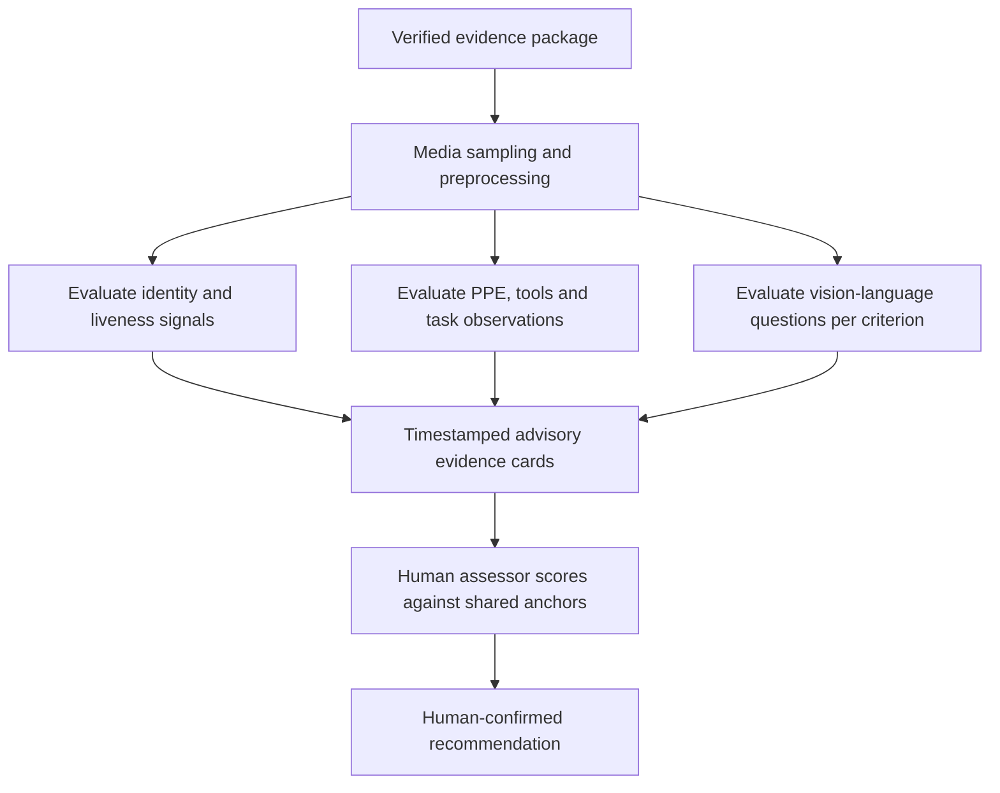

# Roadmap and design boundaries

PARAKH's current implementation is an offline-first prior-skill assessment workflow with a single Assistant Electrician pilot pack. The broader KaushalPramaan design describes a direction for expanding that foundation.

This roadmap draws on the two project references supplied for the README:

- **PARAKH SIH Master Project Reference**, prepared 19 October 2026: a source-linked review of the implemented system.
- **KaushalPramaan PS26242 Master Design & Implementation Document**, version 1.0, 6 October 2026: the wider design, targets and proposed research work.

The PDFs were used as references and are not copied into this repository. Current source and newer dated evidence take priority when a reference describes an older flow. In particular, password assessor accounts and signed negative outcomes supersede earlier review and report behavior.

## Delivered foundation

The implementation connects offline onboarding and declaration, real CameraX media, advisory quality/hand analysis, automatic optimization, protected sealing, resumable upload, criterion scoring, targeted reassessment and signed reports. The current matcher explains fit within one QP; it does not search a national multi-trade catalog.

## Proposed sequence

| Stage | Work | Evidence needed before a stronger claim |
|---|---|---|
| 1. Pilot correctness | Reconcile N/A criteria across scoring/reporting, document heuristic matching weights, validate signed APK delivery and key/version receipts. | Focused regressions, repeatable artifact receipts, preservation of historical report meaning. |
| 2. Assessor authority | Approved assessor roster, qualification checks, scoped assignments and clear retention/recovery policy. | Access-control checks and an explicit operator policy for private evidence. |
| 3. Independent field validation | Trade-expert review of tasks and rubrics; consented workers; scene-separated data; frozen holdout; unaided Hindi/English usability. | Actual assessor agreement, worker outcomes and held-out model/threshold measurements. |
| 4. Identity support | Investigate enrollment liveness, presentation-attack detection, face bookends and spoken challenges. | Consent and privacy design, identity/error metrics, failure and fallback handling on representative devices. |
| 5. Richer evidence analysis | Evaluate PPE/tool detection, meter/step evidence, timestamped PC references, and vision-language model suggestions. | Domain labels, evidence grounding, false-warning analysis and human review of model errors. |
| 6. Broader assessment | Knowledge questions, viva recordings, blind-first scoring experiments, more trades and languages. | New source-pinned packs, task sufficiency review and measurable consistency/usability results. |
| 7. Wider deployment | Lower-cost device support, field connectivity, retention operations and authorized certification-system interfaces. | Device/network benchmarks and an agreed institutional deployment process. |

These stages describe a proposed order, without delivery dates or a claim that unimplemented features are underway.

## Future analysis workflow

This diagram is **planned scope**. The present backend extracts media metadata and supports review; it does not run the design's complete automated visual assessment cascade.

The master design names YOLO and Qwen vision models as candidates. Specific model versions, licensing, hardware requirements and evaluation thresholds should be selected and checked at implementation time. No such model is presented in the README as part of the current scoring path.

## Targets that remain targets

- A fixed compression-reduction percentage: actual reduction depends on source media and encoding conditions. The current product enforces final byte budgets.
- A full-package GPU analysis time: the proposed multi-model server pipeline is not the present deployed workload.
- ≥90% hand-presence agreement: the recorded proxy result is below that threshold.
- Improved inter-assessor consistency: the repository contains a synthetic statistics harness, without an independent real-assessor study.
- Entry/mid-tier latency: the current physical-device evidence centers on OnePlus 13R.
- Official certification: integration or authority must be established separately. The implemented artifact is an assessor recommendation.

[Implementation evidence](IMPLEMENTATION_STATUS.md) · [Assistance acceptance](../gates/Q2_Q3_acceptance.md) · [Synthetic-study limitations](../../ml/study/reports/synthetic_validation.md)
